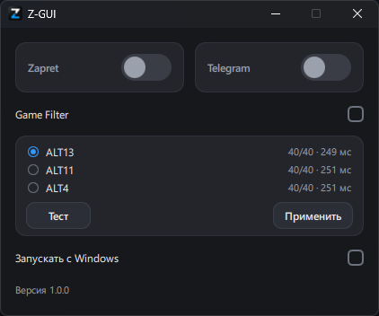

# Z-GUI

GUI для flowseal zapret и tg-ws-proxy.

Windows 10/11 x64. Права администратора.

## Скачать

  

SHA-256: <code>6D85A21EC1B25AE1CF9175311E3AAD2A68EC3578FC9565BE6C5BF1F35351C2AB</code>

  

## Лицензии

[licenses](licenses)
